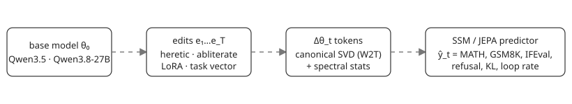

<p align="center"></p>

<h1 align="center">wsp-lab</h1>
<p align="center"><a href="https://gitlab.com/ArioMoniri/wsp-lab/-/pipelines"></a></p>

## The question

If you change the weights of a language model, can you tell from the weight change alone how its benchmark scores moved, without running the edited model?

A blog post by Takehi et al. on [weight-space programming](https://rikiyat.github.io/blog/weight-space-programming/) prompted the question. In it, a frontier model read Qwen3.5-0.8B's weights, edited 0.016% of them without gradients, and raised MATH-500 from 7.9% to 48.1%. The post motivates the question. It does not show that effects can be predicted across edits or models, and that is the step we set out to test.

Can a small model trained on many (weight delta, score change) pairs make the forecast by itself? Does it do better when it sees the whole sequence of edits instead of one edit at a time? The hypotheses H1 to H6, with their thresholds and dated amendments, are in [docs/HYPOTHESIS.md](docs/HYPOTHESIS.md).

## What we built

The zoo is a set of edits to Qwen3.5-0.8B. Each entry is a weight delta with a JSON descriptor that records the seed, config hash, git SHA and pinned base revision. The manifest lists 1,247 entries, and the status block at the end gives the count for each family. The six families are:

| family | what the edit is |
|---|---|
| `random_dir` | ablation of a random direction; the control |
| `abliteration` | refusal-direction removal with Heretic's kernel; parameters sampled, not optimised |
| `heretic_ara` | Heretic ARA runs |
| `lora_sft` | short LoRA fine-tunes on GSM8K training data or the first 5,000 Alpaca-cleaned examples |
| `task_vector` | scaled and merged task vectors |
| `chain` | two to eight edits applied in sequence, each drawn from the families above |

Heretic ARA costs about eight minutes per trial on the shared GPU, so the local config leaves it out. Its runs moved to a rented Lambda GPU under a $150 cap ([docs/PROGRESS.md](docs/PROGRESS.md)). Board A's 5 November review flagged the 12 entries from the first rebuild as unconstrained surrogate-scale diagnostics, excluded from production panels and Heretic-quality comparisons ([review](docs/reviews/P1/heretic-ara-rebuild-forensic-2026-11-05.md); [DECISIONS](docs/DECISIONS.md), D6 addendum 3). The zoo therefore has no production ARA entry yet. A corrected rebuild is running on a rented A10 and has not been qualified.

Merging a LoRA delta into bf16 weights rounds most of it away. About 87% of the non-zero delta entries disappear for a 5-step adapter ([docs/DECISIONS.md](docs/DECISIONS.md), D1). The zoo therefore stores the effective delta, `bf16(W + Δ) − W`, and evaluates that.

The evaluation battery has three tiers, because the base model falls into repetition loops in most generations. Long generations cost a lot whatever the score. The fast tier generates up to 1,024 new tokens on small fixed subsets of GSM8K, MATH-500 and IFEval. It scores MMLU-Pro and HellaSwag by choice log-likelihood, and it adds refusal rate and KL to the base model. The cheap tier runs 100 to 300 items per benchmark, with generations capped at 4,096 tokens. The faithful tier uses the blog's 32,768 tokens and is kept for the base model and a few entries. Item lists are fixed under `configs/eval_subsets/`, and every per-item record is kept.

Feature extraction turns each delta into per-tensor statistics and canonical SVD tokens in the style of W2T. It pools them by tensor type, with separate handling for Qwen3.5's hybrid linear-attention layers. Trajectory splits group entries by ancestry root, so a chain and its parents never land on opposite sides of a split. The feature table covers 1,235 entries and is marked finished in the status block.

The predictor code in `src/wsp/predictor/` holds the splits, the baselines and the scan kernels. The protocol v2 suite runs on the 300-entry D3 subset. It compares the learned predictors, including M1 and M2 with matched variants, against StatNN and against two controls: a descriptor-only model that sees edit metadata but no weight statistics, and a delta-norm baseline. Each learned configuration was run with three seeds, while StatNN and the two controls are single seed-0 fits ([Board A review](docs/reviews/P4/board-a-synthesis-and-v2-2026-11-05.md)).

The editor harness in `src/wsp/editor/` is the offline part of H5. H5 asks whether an LLM editor can reach a given final quality with fewer real evaluations. Board A approved the harness to merge with production disabled ([review](docs/reviews/H5/board-a-editor-final-2026-11-04.md)). The council has since parked paid and editor episodes, so the harness runs offline only. The reader agent in `src/wsp/agents/` belongs to H4, which is parked too.

## What we found

### H1 was not demonstrated

The original H1 criterion was not demonstrated. H1 required a per-benchmark Spearman of at least 0.6 and a win over both StatNN and the norm-of-delta baseline. No learned row reaches 0.6 on either target. Across the 25 complete rows, the highest three-seed mean on HellaSwag is 0.46, from M1-matched on the trajectory split. The highest on MMLU-Pro is 0.45, shared by M1-matched on the trajectory split and M2-matched on the seed split ([discussion](paper/sections/discussion.tex)).

H1 also has a falsification rule: Spearman below 0.3 on all benchmarks after honest tuning. Several rows exceed 0.3, so that rule was not triggered. H1 was therefore not demonstrated, and it was not falsified either.

Seed-0 StatNN is the comparator the learned rows have to beat. On the trajectory split, a matched M1 predictor reached mean Spearman 0.45 and 0.46 on the two targets. Seed-0 StatNN reached 0.57 and 0.65. A descriptor-only model with no weight statistics reached 0.52 and 0.61 on the same seed and split. The gap between StatNN and the descriptor-only model is 0.042 on MMLU-Pro and 0.035 on HellaSwag ([SYNTHESIS §1](docs/council/2026-11-05/SYNTHESIS.md)). In these comparisons, edit metadata ranks edits nearly as well as StatNN, so much of the rank StatNN recovers is also available from metadata ([abstract](paper/sections/abstract.tex)).

On the family split the picture is worse. StatNN is near zero there, at -0.02 on MMLU-Pro and 0.11 on HellaSwag. The three-seed mean of every learned row is below seed-0 StatNN on both targets on the seed and trajectory splits.

### The residual signal is exploratory

With family, device and log-norm terms removed using training folds only, StatNN's relative reduction in residual absolute error against an isotonic-norm comparator is θ = 0.146 [0.069, 0.214] for MMLU-Pro. For HellaSwag it is θ = −0.034 [−0.118, 0.037]. The estimate covers 345 rows and 278 clusters. A negative θ means StatNN does worse than the comparator. The MMLU-Pro interval excludes zero and the HellaSwag interval includes it ([discussion](paper/sections/discussion.tex)).

The estimate is exploratory. The MMLU-Pro result uses accuracy data already used for P4, and it does not confirm H1 under a new protocol.

### Many edits barely move the scores

Only 94 of the 300 D3 entries (31.3%, derived) move KL to the base model by more than 0.01. The count by family is 56 of 60 for LoRA, 30 of 50 for chains, 6 of 30 for task vectors, 2 of 100 for abliteration and 0 of 60 for random directions ([SYNTHESIS §1, item 4](docs/council/2026-11-05/SYNTHESIS.md)). The random-direction family is the control, and none of its 60 entries passes that threshold.

Random-direction edits leave HellaSwag unchanged in every row, and their MMLU-Pro SD is 0.007. Abliteration's SDs are 0.013 and 0.005. Each target moves in steps of one item out of 100, so many edits differ by one item or not at all ([discussion](paper/sections/discussion.tex)).

### Sampled scores are noisy at this size

Each target is a 100-item accuracy with a binomial standard error of 0.045 for MMLU-Pro and 0.049 for HellaSwag at the fast-tier base values of 0.28 and 0.39. That is the error of one score. The item standard error of a paired change is a different quantity. For HellaSwag, the residual SD within family and device is 0.0131, below its item SE of 0.0136. For MMLU-Pro, the residual SD is 0.0384, above its item SE of 0.0246, so item sampling does not account for the MMLU-Pro spread ([discussion](paper/sections/discussion.tex) and [metrology output](docs/council/2026-11-05/metrology_budget_output.txt)).

The repeat data give a partial noise estimate. The base model and ten control entries matched exactly on every metric when re-evaluated on the same device with a fixed seed. Across hosts, the mean absolute difference on 11 edited entries evaluated on the H100 was 0.008 on MMLU-Pro and 0.003 on HellaSwag. The seed-1 panel gives a seed SD of 0.0000 for the two likelihood-scored targets and between 0.0124 and 0.0504 for the five sampled targets. These repeats bound host disagreement on a few entries. They do not measure the reliability of either target across the suite.

HellaSwag accuracy was retired at the second-round reliability gate, where its signal-variance estimate is negative ([round2-metrology](docs/council/2026-11-05/round2-metrology.md), section 1.4). A heuristic population correlation ceiling for MMLU gold-letter log-probability is 0.979 after family and device centering ([SYNTHESIS §1, item 5](docs/council/2026-11-05/SYNTHESIS.md)). That ceiling is a heuristic, not a measured reliability.

### The base model

The base model's 4,096-token run, `p2/base-final-4096`, scored GSM8K 15.5%, MATH-500 6.0%, IFEval 42.0%, MMLU-Pro 20.3% and HellaSwag 51.3%. It refused 99 of 100 harmful prompts. 90.2% of generations on the three generative benchmarks reached the token limit ([RESULTS](docs/RESULTS.md), P2 section; status block below).

GSM8K and MATH-500 land near the blog's 13.8% and 7.9% at one eighth of its token budget. The IFEval figure is about twice the blog's 21.0%, and we do not trust it until the 32k pass is rerun. That pass crashed with a CUDA out-of-memory error while another job held the GPU.

The Mamba-2 CUDA kernels ran a forward and backward pass in 2.65 ms median, against 18.67 ms for a plain PyTorch loop. The timing was taken while another job held the GPU ([BENCH_SSM](docs/BENCH_SSM.md)). The kernels need `scripts/build_mamba.sh` to build on this machine.

## What comes next

The council's verdict is that "the original dedicated weight-space world-model goal is unsupported at this scale; fund a bounded test of within-family teacher-forced effect readability, with a measurement/benchmark paper as the default deliverable. A tree winning is a valid outcome" ([SYNTHESIS](docs/council/2026-11-05/SYNTHESIS.md)).

The bounded test is TF-v1, a readability study on normalized MMLU gold-letter log-probability. It is the endpoint of the pre-registered H1a. Each edit is scored on 1,000 paired items against its actual predecessor. The primary estimand is the same θ as above, now on sealed, fresh, source-closed ancestry components. A pass needs θ ≥ 0.15, a lower 95% bound above zero, a half-width no greater than θ/2, at least 100 valid fresh components and at least 80% power at θ = 0.15, shown in advance. An upper 95% bound below 0.05 on both intervals, on a qualified and powered panel, would end the practical-readability claim for this endpoint. Anything between those bars is inconclusive ([PREREG_H1_TF](docs/PREREG_H1_TF.md); [SYNTHESIS §3](docs/council/2026-11-05/SYNTHESIS.md)).

The budget is 30 local GPU-hours. The adopted user decisions allow no new Lambda spend and no additional history run ([PREREG_H1_TF](docs/PREREG_H1_TF.md)).

The design is frozen but not executed. The document calls itself a frozen prospective design, pending Board A acceptance and measured execution gates, and it reports no qualification, timing or power result. Board A's 5 November review said REVISE and listed five blocking items: baseline aggregation, a frozen estimand with TF power, measured qualification, provenance with ARA and ancestry closure, and budget and placebo equivalence ([Board A review](docs/reviews/P4/board-a-synthesis-and-v2-2026-11-05.md)). The frozen design is written to address those items. Board A has not accepted it, and no gate has been measured.

If the gates fail, the contribution is a measurement and benchmark report with its negative results. Other work still open: the 32k base-model rerun ([RESULTS](docs/RESULTS.md)) and a second reproduction run, which [PROGRESS](docs/PROGRESS.md) lists as open.

## Review record

| Date | Review | Verdict |
|---|---|---|
| 5 Nov | Board A, protocol v2 and council synthesis ([review](docs/reviews/P4/board-a-synthesis-and-v2-2026-11-05.md)) | Descriptive v2 results usable with qualifications; confirmatory hypotheses unestablished; synthesis REVISE |
| 5 Nov | Board B, final check of the v2 paper ([review](docs/reviews/P4/board-b-v2-results-final-2026-11-05.md)) | APPROVE, with two wording items |
| 5 Nov | Board B, reliability re-review ([review](docs/reviews/P4/board-b-reliability-rereview-2026-11-05.md)) | APPROVE for the scoped revision |
| 4 Nov | Board A, D3 suite ([review](docs/reviews/P4/board-a-d3-suite-2026-11-04.md)) | REVISE; H1 undetermined and not demonstrated |
| 4 Nov | Board A, H5 editor harness ([review](docs/reviews/H5/board-a-editor-final-2026-11-04.md)) | APPROVE to merge with production disabled; the first pilot episode is not yet permitted |

## Running it

```bash
git clone https://github.com/ArioMoniri/wsp-lab && cd wsp-lab
uv venv --python 3.12 .venv && uv pip install --python .venv/bin/python -e ".[dev]"
source scripts/env.sh && pytest -q          # CPU tier; GPU tests need -m gpu
bash scripts/build_mamba.sh                 # only for the CUDA Mamba-2 backend

python -m wsp.zoo.build --config configs/zoo_qwen3.5-0.8b_local.yaml   # every family except Heretic ARA
python -m wsp.eval.run --config configs/eval_cheap.yaml --model Qwen/Qwen3.5-0.8B --out data/runs/p2/<run-id>
python -m wsp.eval.batch --zoo data/zoo/qwen3.5-0.8b --subset d3        # fast tier on the D3 subset
python -m wsp.features.extract --zoo data/zoo/qwen3.5-0.8b --out data/features/qwen3.5-0.8b --workers 4
python scripts/update_readme_status.py                                  # refresh the status block below
```

Anything over two minutes should go through `agent-tmux <name> <cmd>` on the lab server. Weights, deltas and eval records stay out of git. They live in private Hugging Face datasets and sync with `scripts/hf_sync.sh`. A pre-push hook runs `scripts/secret_scan.sh --history`; pre-commit runs ruff and the CPU tests. CI runs on a self-hosted GitLab runner with GPU passthrough (`.gitlab-ci.yml`).

## What is not done

Fast-tier scores exist for 389 entries: the 300-entry D3 subset, which the protocol v2 suite uses, and 89 chain predecessors. Against the 1,247 manifest rows, the other 858 have no fast-tier result.

The projections below rest on one timed entry. A clean fast-tier run on one production abliteration entry took 745 s, about 12.4 minutes, on an otherwise idle local GPU. Extrapolating from that run gives about 62 hours for the 300-entry D3 subset and about 258 hours for all 1,247 manifest rows. Those are projections from a single timed entry, not measurements of either run ([RESULTS](docs/RESULTS.md), D2 timing section).

## Limitations

**Coverage.** The zoo has one base model, Qwen3.5-0.8B, and one tokenizer. Nothing here says anything about larger models or other architectures. The 27B transfer test has not been started.

**Scoring.** Refusal rate is a keyword match on 100 prompts in the cheap tier and 50 in the fast tier. The base model refuses 99 of the 100 cheap-tier prompts, so mild edits have little room to show. The fast tier uses 25 to 100 items per benchmark and the cheap tier 100 to 300, so a single entry's score change will often sit inside sampling noise.

**Targets.** The 260 matched D3 rows with inferred runtime metadata block qualification, and we did not test whether they change the result. The baselines are single seed-0 fits, and their paired intervals condition on those fits. We have not estimated a reliability coefficient for either target, so we cannot say how much of the rank disagreement comes from target noise.

**The edits themselves.** Heretic's abliteration kernels are sampled from a hand-set parameter range instead of being found by its optimiser. Those entries are partial abliterations of widely varying strength, not points on the refusal/KL frontier Heretic would pick. Our kernel also skips the row normalisation that Heretic's default settings apply. The LoRA fine-tunes are short, and the bf16 rounding above removes part of the intended change. Chains reuse parents from the same zoo, so their targets are correlated even with ancestry-grouped splits.

**Review.** Every Board review so far was run by language models, not people, and the paper has not been through an outside reviewer.

## Layout

| Path | Contents |
|---|---|
| `src/wsp/zoo/`, `src/wsp/edits/` | edit generators, the Heretic-parity kernels, refusal-direction extraction, zoo builder and applier |
| `src/wsp/eval/` | benchmark runner, batch evaluator, IFEval checker, report generator |
| `src/wsp/features/`, `src/wsp/predictor/` | feature extraction and pooling, splits, baselines, selective-scan code |
| `src/wsp/editor/`, `src/wsp/agents/` | offline editor harness (H5) and reader agent (H4, parked) |
| `configs/` | zoo and eval configs, fixed benchmark subsets |
| `docs/` | hypotheses, roadmap, decisions, results, infrastructure, writing and review rules |
| `docs/council/` | the 5 November council round: briefs, round reports, metrology output and the synthesis |
| `docs/reviews/` | Board A and Board B review records, by phase |
| `board/`, `sessions/`, `harness/` | agent message board, session notes, lessons |
| `paper/` | TMLR manuscript sections as they pass review |

## Status

<!-- status:start -->

_Generated by `scripts/update_readme_status.py` from artefacts on 2026-11-06T16:32:41Z._

**Zoo** (`data/zoo/qwen3.5-0.8b`): 1259 entries in the manifest.

| family | production | smoke | unlabelled | total |
|---|---:|---:|---:|---:|
| random_dir | 150 | 0 | 3 | 153 |
| abliteration | 200 | 0 | 5 | 205 |
| heretic_ara | 12 | 12 | 1 | 25 |
| lora_sft | 120 | 0 | 1 | 121 |
| task_vector | 80 | 0 | 0 | 80 |
| chain | 655 | 0 | 20 | 675 |

`smoke` entries come from short test builds and `unlabelled` rows predate the eligibility field. The batch evaluator takes only `production` entries by default; feature extraction reads every valid manifest id, whatever its eligibility, and skips entries whose files are not built yet.

**Features**: 901 entries extracted (finished).

**Evals**: no `data/evals/*/index.jsonl` found.

**Base model**: `data/runs/p2/base-final-4096/summary.json` not found.

**Lambda**: no open rows in `board/lambda_spend.md`. The ledger is filled by hand, so check `scripts/lambda.sh ls` for live instances.

**CI** (GitLab, `main`): pipeline 3037570653 on `3579bf4`, status running.

<!-- status:end -->
