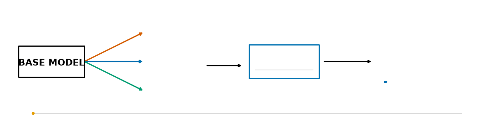

<p align="center"></p>
<p align="center"></p>

<h1 align="center">wsp-lab</h1>
<p align="center"><a href="https://gitlab.com/ArioMoniri/wsp-lab/-/pipelines"></a></p>

## The question

If you change the weights of a language model, can you tell from the weight change alone how its benchmark scores moved, without running the edited model?

The question comes from a blog post by Takehi et al. on weight-space programming (<https://rikiyat.github.io/blog/weight-space-programming/>), in which a frontier model read Qwen3.5-0.8B's weights and edited 0.016% of them, which raised MATH-500 from 7.9% to 48.1%. We are not trying to repeat that. We want to know whether a small model trained on many (weight delta, score change) pairs can do the forecasting step by itself, and whether it does better when it sees the whole sequence of edits instead of one edit at a time. The hypotheses, with the thresholds we committed to before running anything, are in [docs/HYPOTHESIS.md](docs/HYPOTHESIS.md). We expect some of them to fail.

## What exists today

The work so far is the data side: the zoo of edited models, the evaluation battery, the feature extractor, and the review process around them. No predictor has been trained yet.

The zoo is a set of edits to Qwen3.5-0.8B, each stored as a weight delta plus a JSON descriptor with seed, config hash, git SHA and the pinned base revision. There are just over a thousand entries; the table in the status section below gives the current count per family. Six families are implemented: random-direction ablation (the control), refusal-direction abliteration with Heretic's kernel parameters sampled instead of optimised, Heretic ARA runs, short LoRA fine-tunes on GSM8K training data or the first 5,000 Alpaca-cleaned examples, task-vector scaling and merges, and chains of two to eight edits drawn from the others. Heretic ARA is the slow one, at roughly eight minutes per trial on the shared 32 GB GPU, so it was moved to a rented Lambda GPU under a $150 cap. A first job was launched on 4 November; until it finishes and syncs, the zoo holds a single test entry from that family. LoRA deltas are stored after merging into bf16, which rounds away most of the small entries (about 87% for a 5-step adapter in the check we ran). We therefore store the effective delta, `bf16(W + Δ) − W`, and evaluate that; [docs/DECISIONS.md](docs/DECISIONS.md) has the reasoning (D1).

The evaluation battery has three tiers because the base model gets stuck in repetition loops in most of its generations, which makes long generations expensive whatever the score. The fast tier screens zoo entries at 1,024 new tokens on small fixed subsets of GSM8K, MATH-500, IFEval, MMLU-Pro and HellaSwag, plus refusal rate and KL to the base model. The cheap tier runs the full subsets at 4,096 tokens. The faithful tier uses the blog's 32,768 tokens and is meant only for the base model and a handful of entries. Subset item lists are fixed under `configs/eval_subsets/`, and every per-item record is kept.

The base model has been measured once at the cheap tier, run `p2/base-final-4096`: GSM8K 15.5%, MATH-500 6.0%, IFEval 42.0%, and 90.2% of generations on the three generative benchmarks reaching the token limit. GSM8K and MATH-500 land near the blog's numbers at an eighth of its token budget, and the loop rate agrees with its main failure mode. The IFEval figure is about twice what the blog reports and we do not trust it until the 32k pass is rerun; that pass died with a CUDA out-of-memory error while the zoo build was using the GPU. Details and the full table are in [docs/RESULTS.md](docs/RESULTS.md).

Feature extraction turns each delta into per-tensor statistics and canonical SVD tokens in the style of W2T, then pools them to fixed-width vectors by tensor type, with extra care for Qwen3.5's hybrid linear-attention layers. Trajectory splits group entries by the root of their ancestry chain so that a chain and its parents never land on opposite sides of a split. The baselines (a delta-norm ridge, LightGBM on the statistics, an MLP on the spectrum) are written and tested on a toy zoo but have not been run on real scores, because none exist yet.

The sequence model will be a Mamba-2 stack. On this machine (CUDA 13.2, compute capability 12.0) neither `mamba-ssm` nor `causal-conv1d` built out of the box; `scripts/build_mamba.sh` patches both to C++20 and takes about eleven minutes. A forward and backward pass at batch 32, length 64, width 256 took 2.65 ms median with the CUDA kernels against 18.67 ms for a plain PyTorch loop, measured while another job held the GPU ([docs/BENCH_SSM.md](docs/BENCH_SSM.md)).

Every branch goes through two reviews before merging: Board A checks correctness (leakage, seeds, silent fallbacks, provenance), and Board B reads the way a journal reviewer would. Most branches were sent back at least once before they merged. [docs/PROGRESS.md](docs/PROGRESS.md) is the dated log of what was tried and what the boards rejected, and [docs/REVIEW_PROTOCOL.md](docs/REVIEW_PROTOCOL.md) describes the process.

## Running it

```bash
git clone https://github.com/ArioMoniri/wsp-lab && cd wsp-lab
uv venv --python 3.12 .venv && uv pip install --python .venv/bin/python -e ".[dev]"
source scripts/env.sh && pytest -q          # CPU tier; GPU tests need -m gpu
bash scripts/build_mamba.sh                 # only for the CUDA Mamba-2 backend

python -m wsp.zoo.build --config configs/zoo_qwen3.5-0.8b_local.yaml   # every family except Heretic ARA
python -m wsp.eval.run --config configs/eval_cheap.yaml --model Qwen/Qwen3.5-0.8B --out data/runs/p2/<run-id>
python -m wsp.eval.batch --zoo data/zoo/qwen3.5-0.8b --subset d3        # fast tier on the D3 subset
python -m wsp.features.extract --zoo data/zoo/qwen3.5-0.8b --out data/features/qwen3.5-0.8b --workers 4
python scripts/update_readme_status.py                                  # refresh the status block below
```

Anything over two minutes should go through `agent-tmux <name> <cmd>` on the lab server. Weights, deltas and eval records stay out of git; they live in private Hugging Face datasets and sync with `scripts/hf_sync.sh`. CI runs on a self-hosted GitLab runner with GPU passthrough (`.gitlab-ci.yml`).

## What is not done

The fast tier has not been run over the zoo, so there are no per-entry scores and nothing for a predictor to learn from. At the calibrated estimate of 9 to 12 minutes per entry that is on the order of 120 GPU-hours for the full zoo, which is why decision D3 picks a stratified subset of at most 300 entries first. A clean timing of one full-tier entry, and the second base-model reproduction run that the P2 gate requires, are still pending. The 32k base run needs a rerun.

After that come the predictors (a stateless Transformer, the Mamba-2 model, a JEPA-style encoder, and a frontier-LLM reader), the family-held-out and seed-held-out tables for H1 to H4, a 27B transfer test on Lambda, and the forecast-then-verify loop in P6. [docs/ROADMAP.md](docs/ROADMAP.md) lists each with its gate. `src/wsp/predictor/` currently holds the scan kernels, splits and baselines only; there is no training script. The paper in `paper/` has an abstract, introduction and related work, and nothing from the experiments.

## Limitations

The zoo has one base model, Qwen3.5-0.8B, and one tokenizer, so any result says nothing yet about larger models or other architectures; the 27B transfer test is meant to probe that and has not been started. Heretic's abliteration kernels are sampled from a hand-set parameter range rather than found by its optimiser, so those entries are partial abliterations with a wide spread of strength, not the points on a refusal/KL frontier that Heretic would pick. Our abliteration kernel skips Heretic's row normalisation, which its default settings apply. Refusal rate is a keyword match on 100 prompts. The base model refuses 99 of them, which leaves little room to see differences between mild edits. The subsets are small (25 to 300 items per benchmark in the fast and cheap tiers), so single-entry score changes will often sit inside sampling noise, and many zoo entries will differ from the base by less than that. Chains reuse parents from the same zoo, so their targets are correlated even with ancestry-grouped splits. The LoRA fine-tunes are short, and the bf16 rounding noted above affects how much of the intended change survives. Finally, every Board review so far was run by language models, not people, and the paper has not been through an outside reviewer.

## Layout

| Path | Contents |
|---|---|
| `src/wsp/zoo/`, `src/wsp/edits/` | edit generators, the Heretic-parity kernels, refusal-direction extraction, zoo builder and applier |
| `src/wsp/eval/` | benchmark runner, batch evaluator, IFEval checker, report generator |
| `src/wsp/features/`, `src/wsp/predictor/` | feature extraction and pooling, splits, baselines, selective-scan code |
| `configs/` | zoo and eval configs, fixed benchmark subsets |
| `docs/` | hypotheses, roadmap, decisions, results, infrastructure, writing and review rules |
| `board/`, `reviews/`, `sessions/`, `harness/` | agent message board, review records, session notes, lessons |
| `paper/` | TMLR manuscript sections as they pass review |

## Status

<!-- status:start -->

_Generated by `scripts/update_readme_status.py` from artefacts on 2026-11-04T06:16:54Z._

**Zoo** (`data/zoo/qwen3.5-0.8b`): 1110 entries in the manifest.

| family | production | unlabelled | total |
|---|---:|---:|---:|
| random_dir | 150 | 3 | 153 |
| abliteration | 200 | 5 | 205 |
| heretic_ara | 0 | 1 | 1 |
| lora_sft | 120 | 1 | 121 |
| task_vector | 80 | 0 | 80 |
| chain | 530 | 20 | 550 |

`production` entries are the ones the eval and feature steps use; `smoke` entries come from short test builds, and `unlabelled` rows predate the eligibility field and are excluded.

**Features**: 658 entries extracted (extraction not finished).

**Evals**: 0 index rows, 0 entries, 0 with a complete result.

**Base model** (Qwen3.5-0.8B, run `p2/base-final-4096`, 4096 new tokens, percent):

| GSM8K | MATH-500 | IFEval | MMLU-Pro | HellaSwag | loop rate | refusal rate |
|---:|---:|---:|---:|---:|---:|---:|
| 15.5 | 6.0 | 42.0 | 20.3 | 51.3 | 90.2 | 99.0 |

**Lambda**: no open rows in `board/lambda_spend.md`. The ledger is filled by hand, so check `scripts/lambda.sh ls` for live instances.

**CI** (GitLab, `main`): pipeline 3025426390 on `bf99575`, status success.

<!-- status:end -->
